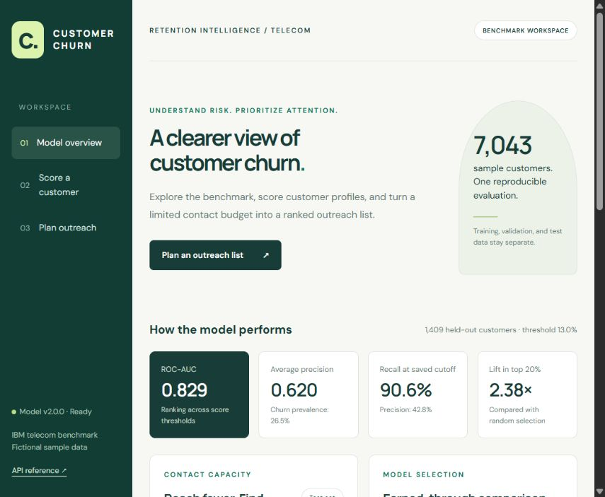

# Customer Churn Workbench

A telecom churn benchmark and retention planning application. Score a customer profile, rank a CSV by churn probability, and select an outreach list using a contact budget or score threshold.

Built with Python, scikit-learn, FastAPI, and a responsive JavaScript interface. Training and inference share one fitted preprocessing/model pipeline.



## What it does

- Compares a prior-only baseline, two logistic regression configurations, and gradient boosting with four-fold cross-validation.
- Separates training, threshold selection, and final evaluation into disjoint customer splits.
- Shows ranking metrics, probability calibration, confusion counts, validation permutation importance, and contact-capacity results.
- Scores individual customers and CSV batches of up to 1,000 rows / 1,000,000 bytes.
- Exports ranked customer scores and contact decisions. Uploads are processed in memory and are not persisted by the application.
- Validates categories, numeric values, unique identifiers, and service consistency. Invalid batches are rejected as a whole.

## Run locally

Use **Python 3.12**. Run the following from the project directory in PowerShell:

```powershell
python -m venv .venv
.\.venv\Scripts\python.exe -m pip install -r requirements.lock.txt
.\.venv\Scripts\python.exe scripts/download_data.py
$env:OMP_NUM_THREADS="2"
.\.venv\Scripts\python.exe -m churn.train
.\.venv\Scripts\python.exe -m uvicorn churn.api:app --host 127.0.0.1 --port 8002
```

Open [the workbench](http://127.0.0.1:8002) or [the API reference](http://127.0.0.1:8002/docs). Stop the server with Ctrl+C. After initial installation and training, `Start-Workbench.ps1` starts the existing environment and model.

On macOS/Linux, use `python3 -m venv .venv` and `.venv/bin/python` in place of the Windows interpreter path. Set `OMP_NUM_THREADS=2` with `export OMP_NUM_THREADS=2`. Dependency installation and dataset download need internet access; inference uses local artifacts. The optional interface font request has a system-font fallback.

`requirements.txt` pins direct dependencies; `requirements.lock.txt` records the complete tested environment. Models are not downloaded or loaded from the legacy project. Train the local model before starting the server. Missing or mismatched artifacts produce an actionable HTTP 503 response.

## Try the workflows

1. **Model overview:** inspect held-out performance, cross-validation comparison, contact-capacity chart, feature importance, and calibration.
2. **Score a customer:** load an example profile and submit. Moving the threshold changes the contact decision, while the predicted probability stays fixed for the same profile.
3. **Plan outreach:** download the benchmark CSV example, upload it, and select a contact budget of 5. The result contains 20 ranked profiles with exactly 5 selected contacts. Download the scored CSV.

The example CSV is an excerpt of the fictional benchmark test set, not a set of live incoming customers.

## Recorded benchmark

Data: 7,043 customers, 26.54% churn prevalence. Split: 4,225 training / 1,409 validation / 1,409 test customers; seed 42. Selected estimator: histogram gradient boosting, based on mean training cross-validation average precision.

| Held-out measure | Result |
| --- | ---: |
| ROC-AUC | 0.829 |
| Average precision | 0.620 |
| Brier score, lower is better | 0.143 |
| Precision at validation-selected threshold 0.13 | 42.8% |
| Recall at validation-selected threshold 0.13 | 90.6% |
| Accuracy at threshold 0.13 | 65.4% |
| Precision / recall at threshold 0.50 | 62.3% / 48.7% |
| Precision among top-scoring 20% | 63.1% |
| Churners captured in top-scoring 20% | 47.6% |
| Lift in top-scoring 20% versus random selection | 2.38× |

The recall-oriented cutoff flags 792 of 1,409 test customers: 339 true positives and 453 false positives. It is a demonstration policy, not a proven business optimum. A small contact budget may be more appropriate than this threshold. Exact results, four-fold scores, confusion matrices, and bootstrap intervals are in `artifacts/report.json`; the dashboard reads this file through the API.

The previous homemade synthetic dataset and this benchmark differ, so their reported scores are not a controlled before/after performance comparison.

## Data and model documentation

- [Data provenance and input dictionary](docs/DATA.md)
- [Model card and evaluation protocol](docs/MODEL_CARD.md)
- [Architecture and API contract](docs/ARCHITECTURE.md)
- [IBM source repository](https://github.com/IBM/telco-customer-churn-on-icp4d)
- [scikit-learn guidance on pipelines and leakage](https://scikit-learn.org/stable/common_pitfalls.html)

The download is pinned to an IBM Git commit and verified against `data/source.json`. IBM describes this as a **fictional** telecom sample. The upstream repository carries an Apache-2.0 license; its license text is retained in `data/UPSTREAM_LICENSE.txt`.

The dataset has no timestamped customer history. Random stratified evaluation does not validate a future forecasting horizon. Model scores are associations with the benchmark label. They do not establish causal churn drivers, retention uplift, or financial savings. Excluding demographic fields does not establish fairness.

## Test

After downloading data and training:

```powershell
.\.venv\Scripts\python.exe -m pytest -q
```

Tests cover prediction parity, input validation, batch atomicity and limits, stable ranking, budget selection, artifact checksums, disjoint splits, training-only imputation statistics, report consistency, and unavailable models. The GitHub workflow installs the lock file, downloads the pinned dataset, retrains, and runs these tests on Python 3.12.

## Repository map

```text
churn/
  schema.py       Shared feature contract and validation
  train.py        Full experiment and artifact generation
  service.py      Trusted artifact loading and scoring
  api.py          Web and API routes
scripts/
  download_data.py
web/
  index.html      Product interface
  app.js          Forms, charts, CSV export
  style.css       Responsive styles
data/
  source.json     Pinned source, checksum, attribution
  examples/       Unlabeled benchmark excerpt for the app
  raw/            Downloaded source (ignored by Git)
artifacts/
  report.json     Recorded evaluation and runtime metadata
  splits.json     Customer IDs assigned to each split
  pipeline.joblib Locally trained pipeline (ignored by Git)
tests/
docs/
```

## Operating boundaries

This version runs as a local application with no accounts, authorization, database, or prediction-history storage. Bind it to `127.0.0.1` for local use. Public deployment requires authentication, TLS, appropriate request/rate limits, privacy controls, and operational monitoring. A checksum detects artifact mismatch; it is not an authenticity signature. Only load joblib files produced by a trusted training run.

Future work should begin with timestamped, consented operational data, temporal validation, subgroup evaluation, drift monitoring, and a controlled intervention experiment before claiming retention impact.
