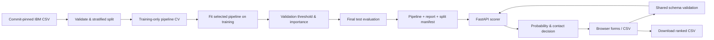

# Architecture and API contract

## Components



`churn/schema.py` is the single input definition for training, JSON, and CSV. `churn/train.py` builds a ColumnTransformer/Pipeline and serializes the complete fitted object. `churn/service.py` verifies the artifact hash against its report and calls the fitted pipeline. `churn/api.py` serves static files and API routes. `web/app.js` creates the forms from the schema, renders the saved evaluation, and exports scores.

There is no database or external inference service. The startup lifespan loads the model once into memory. A missing artifact or checksum mismatch leaves the API unready; the health/report/scoring endpoints respond with 503 and a training instruction. Restart the server after retraining so memory and disk describe the same model. Training is an offline operation, not a web endpoint. It should run while the serving process is stopped.

## Routes

| Method | Route | Purpose |
| --- | --- | --- |
| GET | `/` | Workbench |
| GET | `/api/health` | Ready status and model version; 503 if unavailable |
| GET | `/api/schema` | Feature names, numeric bounds, categorical values, upload limits |
| GET | `/api/report` | Recorded model selection and evaluation; not live customer metrics |
| GET | `/api/example.csv` | 20 unlabeled benchmark profiles |
| POST | `/api/predict` | Score one JSON customer |
| POST | `/api/batch` | Score raw UTF-8 CSV body |
| GET | `/docs` | Interactive OpenAPI documentation |

### Individual request

Send `Content-Type: application/json`. An optional query parameter `threshold` overrides the saved cutoff for that request; allowed interval is 0.01–0.99 inclusive.

```json
{
  "tenure": 8,
  "MonthlyCharges": 84.5,
  "TotalCharges": 676,
  "Contract": "Month-to-month",
  "InternetService": "Fiber optic",
  "OnlineSecurity": "No",
  "TechSupport": "No",
  "OnlineBackup": "Yes",
  "DeviceProtection": "No",
  "PaymentMethod": "Electronic check",
  "PaperlessBilling": "Yes",
  "PhoneService": "Yes",
  "MultipleLines": "No",
  "StreamingTV": "Yes",
  "StreamingMovies": "No"
}
```

### Batch request

Send the file directly as the request body with `Content-Type: text/csv`. This is **not** multipart/form-data. Query parameters:

- `threshold`: same interval as individual scoring. Defaults to the saved cutoff.
- `budget`: optional integer, 1–1000, and no larger than the uploaded row count. Selects exactly the first N ranked customers, independent of threshold.

Example using curl:

```sh
curl -X POST 'http://127.0.0.1:8002/api/batch?budget=5' \
  -H 'Content-Type: text/csv' \
  --data-binary @data/examples/customers.csv
```

If both budget and threshold are supplied, budget controls `selected_for_contact`, and threshold controls `above_threshold`. These fields deliberately represent different decisions. The browser displays the active selection rule. Sorting uses descending full-precision probability, with original input order as the tie-breaker. Rounded UI percentages do not determine rank.

### Response

Both scoring endpoints return:

```json
{
  "model_version": "2.0.0",
  "threshold": 0.13,
  "selection_rule": "top_n",
  "customer_count": 20,
  "contact_count": 5,
  "mean_probability": 0.2867,
  "results": [
    {
      "customer_id": "example-id",
      "churn_probability": 0.824,
      "above_threshold": true,
      "rank": 1,
      "selected_for_contact": true
    }
  ]
}
```

This response is illustrative and shortened. Actual results contain every validated input customer. The individual endpoint uses `selection_rule: threshold` and a generic display identifier. `above_threshold` uses an inclusive `>=` comparison.

## Failure behavior

- **413:** file exceeds 1,000,000 bytes, or more than 1,000 nonblank customer rows. Body length is checked while streaming, rather than trusting Content-Length.
- **415:** batch request has the wrong content type.
- **422:** missing/unknown/duplicate headers, malformed UTF-8 or CSV, wrong column count, bad feature values, incompatible services, duplicate/oversized IDs, empty batches, or invalid query parameters.
- **503:** locally trained model unavailable or inconsistent with its report.

Batch validation is atomic: no predictions are returned if any row fails validation. The response includes the invalid-row count and up to ten row-error details. CSV line labels start at 2 after the header; quoted multiline cells can make logical record labels differ from physical text-line numbers. A label column such as Churn is rejected as unexpected. Limits protect this local workflow; they do not replace production gateway controls.

## Browser behavior

- Text, including customer IDs, is rendered with textContent rather than interpreted as HTML.
- Exported CSV quotes and escapes every value. Cells that could be spreadsheet formulas are prefixed with an apostrophe. This can alter exported display identifiers intentionally; server scoring uses the original identifier.
- Editing inputs clears the previous result to avoid presenting an old score as the current profile's score.
- Native labels, keyboard focus styles, radio groups, table headers, and live result/error regions support keyboard and assistive-technology use.
- Charts are SVG with text alternatives. Layout adapts to narrow screens; large tables scroll horizontally.
- Evaluation statistics remain tied to the saved benchmark policy. Changing a scoring threshold does not silently recalculate or relabel held-out model metrics.

## Tests and extension points

The integration suite compares JSON and CSV probabilities to direct pipeline inference, checks held-out split separation and training-only imputer medians, and exercises error paths and exact top-N behavior. UI testing additionally checks example scoring, CSV upload/ranking, and export.

For a future hosted service: add authenticated users, authorization for customer data, validated storage/retention rules, request and concurrency controls, trusted artifact promotion, drift/quality monitoring, and an external evaluation dataset. Do not treat the local SHA-256 check as a signature or accept arbitrary uploaded joblib files.
